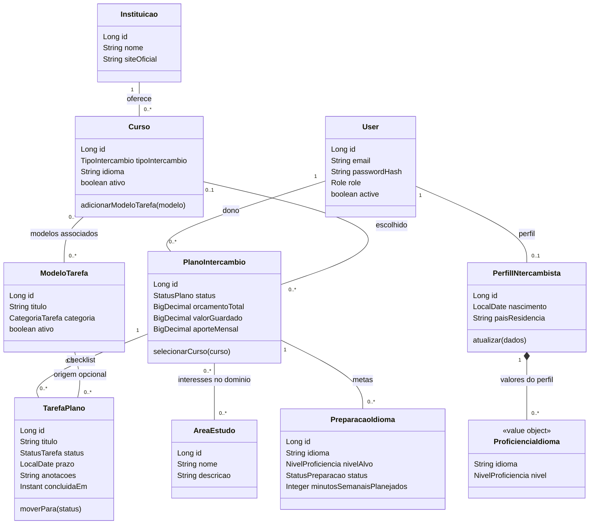
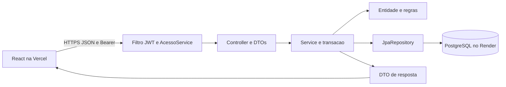
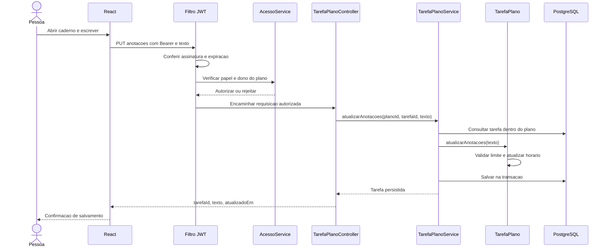
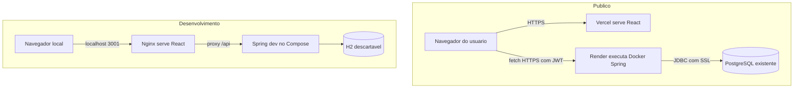

# Diagramas do Berxy

Diagramas conferidos com o código em 02/11/2026. As fontes `.mmd` são editáveis;
o GitHub renderiza os blocos Mermaid abaixo. A versão SVG do domínio pode ser
aberta diretamente no navegador e usada na apresentação.

## Classes e relações

[Diagrama em SVG](diagramas/dominio.svg) · [Fonte Mermaid](diagramas/dominio.mmd)

A multiplicidade junto à classe indica quantas instâncias dela podem se relacionar
com uma instância da outra ponta. Curso é opcional no plano; modelo é opcional na
tarefa. ProficienciaIdioma é um objeto de valor pertencente ao perfil, sem identidade
própria. Os demais vínculos não significam automaticamente cascade remove. A associação
de áreas está no domínio, mas ainda não possui rota para manutenção no plano.

## Camadas de uma operação

Repositories são interfaces implementadas pelo Spring. O service consulta as relações
na transação; DTOs de saída evitam ciclos do grafo JPA. CORS é configurado no backend.

## Sequência de salvamento de anotações

Este é o fluxo de sucesso. JWT inválido termina em 401; falta de permissão em 403;
tarefa inexistente no plano em 404; texto inválido em 400. Nenhuma dessas falhas
precisa alterar o status da tarefa ou apagar o texto que a interface ainda mantém.

## Implantação pública e desenvolvimento

O Compose padrão na porta 3000 também pode acessar PostgreSQL com credenciais do
ambiente. O diagrama de desenvolvimento representa especificamente o modo `-Local`
usado nas verificações, que não grava no banco publicado. A Vercel não executa o
Nginx do Compose e não usa o prefixo `/api` na URL pública do backend.
