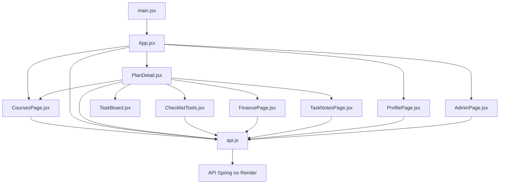

# Guia dos arquivos do frontend Berxy

Revisão de 02/11/2026. Este repositório contém apenas interface e operação local;
entidades, regras definitivas e persistência estão no backend. A interface é React
com JavaScript/CSS. Não há React Router: a navegação atual usa estado em App/PlanDetail.
A URL não identifica diretamente um plano ou caderno e recarregar exige novo login.

## Arquivos de implementação

| Arquivo | Responsabilidade e colaboração |
|---|---|
| src/main.jsx | Monta App na raiz do HTML e importa o CSS global |
| src/App.jsx | Página pública, cadastro/login, token/usuário em memória, menu, visão geral, planos e formulário de plano; monta PlanDetail, ProfilePage e AdminPage |
| src/PlanDetail.jsx | Resumo do plano, curso, checklist e preparação de idioma; coordena tarefas, estado de erro/sucesso e abas; monta FinancePage e a página de caderno |
| src/CoursesPage.jsx | Meus cursos: cadastro/edição pessoal, etiquetas, filtro, datas, link e adição ao cronograma; CourseEditor é o formulário interno |
| src/TaskBoard.jsx | Quadro de três estados; cards recolhíveis, arraste nativo, seletor, prazo, edição/remoção e acesso ao caderno; delega persistência aos callbacks do plano |
| src/ChecklistTools.jsx | Escolha recolhível de temas, geração aditiva e criação/edição de tarefa própria; usa API real e atualiza a lista do plano |
| src/TaskNotesPage.jsx | Página do caderno: carrega/salva texto da tarefa, sugestões por tema/categoria, modelo só em texto vazio, limite, horário e confirmação de saída sem salvar |
| src/FinancePage.jsx | Formulário de meta/reserva/aporte e exibição dos cálculos retornados pelo backend; atualiza orçamento do plano após salvar |
| src/ProfilePage.jsx | Perfil, nacionalidades, proficiências, conta e troca de senha; consulta e atualiza dados do usuário conectado |
| src/AdminPage.jsx | Catálogos de instituições, áreas, cursos e modelos; formulários, ativação/desativação e associação de modelos a cursos; visível para ADMIN |
| src/api.js | API_URL, fetch, Bearer, sinal de cancelamento, serialização JSON, resposta 204, ApiError e getErrorMessage; aceita diferentes formatos de erro do backend |
| src/types.js | Dicionários de rótulos dos enums da API; apesar do nome, é JavaScript e não define tipos TypeScript |
| src/components.jsx | Icon, Logo, Bear, Button, StatusBadge, EmptyState, Notice e Spinner; componentes de apresentação reutilizados pelas páginas |
| src/useDialog.js | Hook de foco para diálogos: foco inicial, Tab preso no modal, Escape, restauração de foco e bloqueio de scroll |
| src/index.css | Cores, tipografia, componentes, formulários, quadro, caderno e responsividade; sem biblioteca de estilo |
| tests/api.test.mjs | Oito testes Node do contrato do cliente HTTP, erros, Bearer, texto e 204 |

## Como os componentes se relacionam

components.jsx, types.js e index.css são compartilhados pelas telas. useDialog é
usado em formulários modais e na confirmação de saída do caderno. TaskBoard não
chama fetch diretamente: recebe ações de PlanDetail. TaskNotesPage salva em uma
rota própria; sua descrição não é usada como substituto para o caderno.

## Estado e segurança

App guarda token/usuário e desmonta os fluxos privados ao sair. O token não vai para
localStorage. Respostas da sessão anterior são descartadas quando o token já mudou.
O backend continua responsável por autorização: ocultar Administração no menu não
protege a API por si só. AcessoService e o filtro verificam as requisições reais.

TaskNotesPage registra em App uma função que intercepta navegação/logout quando
há texto pendente. O usuário pode continuar escrevendo ou sair sem salvar. Também
há beforeunload para fechar/recarregar a aba. O texto salvo vive no PostgreSQL,
não na função de navegação. Não há mesclagem concorrente ou salvamento automático.

## Configuração e publicação

| Arquivo | Responsabilidade |
|---|---|
| package.json | Scripts, React e dependências de desenvolvimento |
| package-lock.json | Versões resolvidas para instalações reprodutíveis com npm ci |
| vite.config.js | Plugin React e configuração Vite |
| index.html | Documento HTML e raiz em que React é montado |
| .env.example | Exemplo público de VITE_API_URL; não contém segredo |
| .env.docker.example | Caminho do backend/porta e instruções de variáveis do Compose |
| Dockerfile | Node executa testes/build; Nginx serve os arquivos gerados |
| docker/nginx.conf | Arquivos estáticos, fallback index.html, cache e proxy /api para backend:8080 |
| compose.yaml | Backend + frontend; perfil prod por padrão, porta local e healthchecks |
| compose.local.yaml | Sobrescreve somente o backend para dev/H2 e chave exclusiva de teste |
| scripts/iniciar-docker.ps1 | Confere pastas/Docker, pede credenciais quando necessário e inicia o modo escolhido |
| .dockerignore | Exclui arquivos que não devem ir ao contexto do build |
| .gitignore | Ignora node_modules, dist, artefatos locais e segredos |
| AGENTS.md | Instruções do repositório para automação; não faz parte da aplicação |
| CLAUDE.md | Instruções auxiliares locais do repositório; não implementa funcionalidades |
| README.md | Entrada e estado atual do frontend |
| DOCKER.md | Execução local e distinção entre modo PostgreSQL e H2 |
| DEPLOY-VERCEL.md | Configuração Vercel e atualização pela main |
| public/berxy-logo.png | Versão principal do logotipo utilizada por Logo |
| public/berxy-logo-outline.png | Variação do logotipo para contextos visuais do projeto |
| public/favicon.svg | Ícone da aba do navegador |
| docs/GUIA-FRONTEND.md | Este manual de manutenção e integração |

VITE_API_URL é incorporada no build. Mudar a variável em produção exige rebuild.
Na Vercel é https://berxy-api.onrender.com; no Compose é /api. O Nginx retira o
prefixo /api antes de encaminhar ao Spring. O site público não depende do Docker
Desktop da máquina de nenhum integrante.

## Verificações e manutenção

Executar npm test e npm run build após mudanças no cliente. Mudanças em endpoints
exigem ler o contrato real do backend e atualizar as duas pontas. Não simular sucesso
ou persistência quando a API falha. Manter carregamento, erro, estado vazio e confirmação
de salvamento claros. Testar mensagens com a API autorizada, sem inserir fixtures no banco
compartilhado do grupo; o Compose -Local oferece H2 para esse propósito.

## Leitura do backend

[Manual do grupo](https://github.com/RafaSantos398/Projeto_Final_Arquitetura_de_objetos_ageis/blob/main/docs/GUIA-DO-GRUPO.md) ·
[API](https://github.com/RafaSantos398/Projeto_Final_Arquitetura_de_objetos_ageis/blob/main/docs/API.md) ·
[Diagramas](https://github.com/RafaSantos398/Projeto_Final_Arquitetura_de_objetos_ageis/blob/main/docs/DIAGRAMAS.md) ·
[Revisão de escopo](https://github.com/RafaSantos398/Projeto_Final_Arquitetura_de_objetos_ageis/blob/main/docs/REVISAO-ESCOPO.md).

## Cursos pessoais em 03/11/2026

CoursesPage funciona no menu Meus cursos e dentro do plano. No menu, busca os planos
para escolher em qual cronograma inserir; dentro do plano, usa o plano já aberto e
atualiza a lista de tarefas via callback. Formulário usa checkboxes nativos para várias
etiquetas e não consulta instituições obrigatórias. CourseEditor salva no endpoint pessoal.
AdminPage filtra pessoais para não misturar seu formulário de catálogo com este fluxo.
PlanDetail filtra pessoais fora da seleção de curso principal e mostra o catálogo em
seção recolhível. TaskBoard identifica a origem como Meu curso, com caderno por tarefa.
